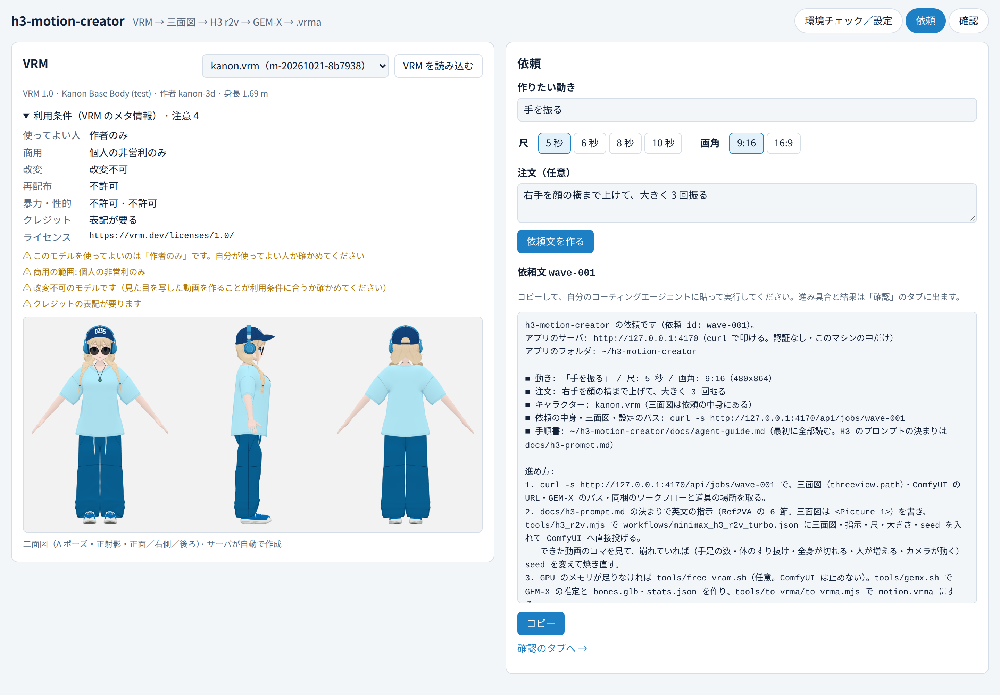
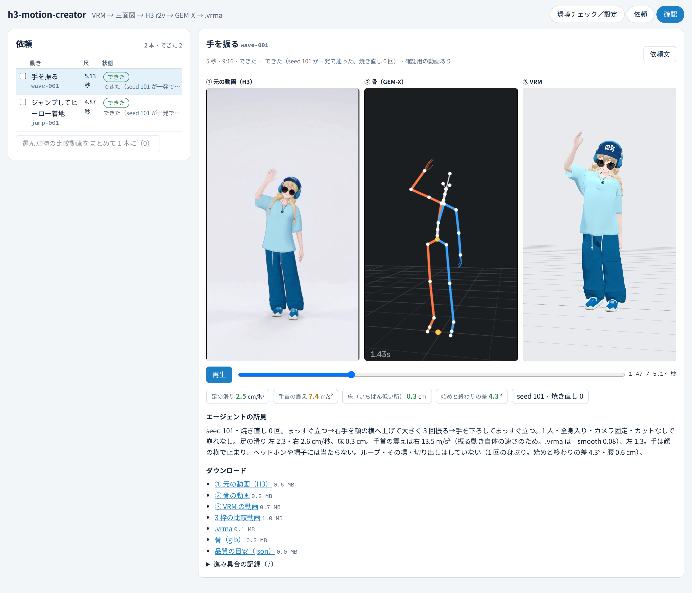

# h3-motion-creator

**VRM を 1 体読み込んで、作りたい動きを言葉で入れるだけで、そのモデル用のモーション（`.vrma`）ができる作業台です。**

VRM から A ポーズの三面図を作り、それを参照にして MiniMax H3 で「そのモデル自身が動く動画」を生成します。その動画から GEM-X で骨の動きを取り出し、VRM Animation にします。
動画のもとがモデル自身なので、体形や髪・帽子などの小物に合った動きになりやすく、手が顔や体に刺さりにくくなります。

```
VRM ──▶ 三面図 ──▶ H3（参照つきの動画生成）──▶ GEM-X（骨の推定）──▶ .vrma
```

重い処理は、あなたが普段使っているコーディングエージェントに任せます。画面で作った**依頼文をコピーして貼るだけ**です。アプリがエージェントを呼ぶことはないので、エージェントの種類は問いません。

## 流れ

1. **VRM を読み込む** — 三面図が自動でできます
2. **動きを入れて依頼文をコピー** — 「手を振る」「走る」など。自分のエージェントに貼って実行させます
3. **待つ** — エージェントが動画を作り、骨を取り出し、`.vrma` にして戻してきます
4. **確認する** — 元の動画・骨・VRM を並べて同時に再生。気に入ったらダウンロード


*依頼: VRM の利用条件と三面図を見ながら、動きを入れて依頼文を作る*


*確認: ① 元の動画 ② 骨 ③ VRM を同じ時刻で並べ、品質の目安と所見を見てダウンロード*

## はじめかた

```bash
npm install
npm run setup:browser   # 初めの 1 回だけ
npm run build
npm start               # → http://127.0.0.1:4170
```

開いたら、まず「環境チェック／設定」タブで ComfyUI と GEM-X の場所を選びます。
足りない物があれば、それを入れるための**セットアップの依頼文**が出るので、これもエージェントに貼れば準備してくれます。

## もっと知りたいとき

- [`docs/design.md`](docs/design.md) — 設計書
- [`docs/setup.md`](docs/setup.md) — セットアップの手順
- [`docs/agent-guide.md`](docs/agent-guide.md) — エージェント向けの手順書

## ライセンス

Apache License 2.0。同梱している他者の物は [`THIRD_PARTY_NOTICES.md`](THIRD_PARTY_NOTICES.md) を見てください。モデルの重みは同梱していません。使うモデルはそれぞれの配布元の決まりに従ってください。
